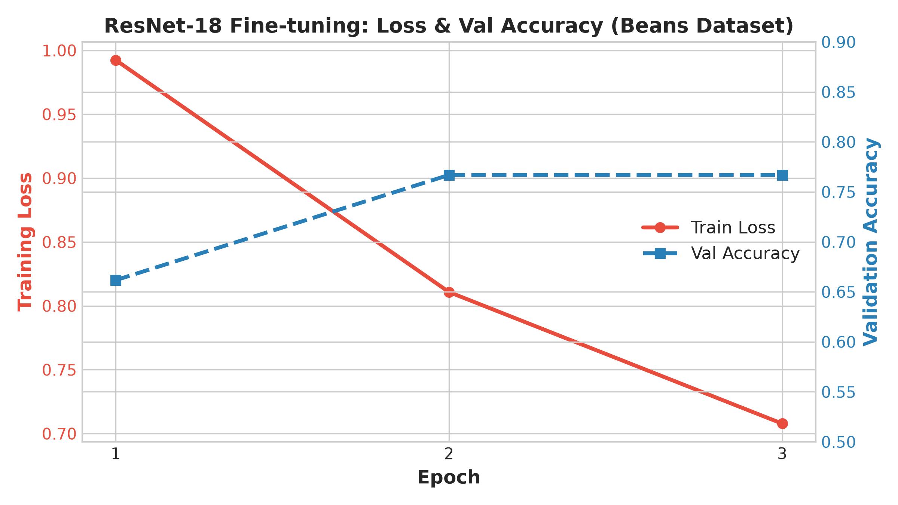

# ResNet18 콩잎 3클래스 Fine-tuning 결과보고서

- **평가 대상:** 콩잎 질병 이미지 3종 분류 (`angular_leaf_spot`, `bean_rust`, `healthy`)
- **기준 모델:** `microsoft/resnet-18` (Apache-2.0)
- **학습 방식:** Head-only Fine-tuning (Backbone freeze)
- **입력 데이터:** `dataset/train`, `dataset/val`
- **최종 보관 데이터:** `dataset/test` (학습에 사용하지 않음)
- **모델 저장 위치:** `artifacts/beans_resnet18/`
- **실험 상태:** 실행 완료 (실측값 반영)

---

## 1. 데이터 구성

| 클래스 | Train (학습용) | Validation (검증용) | Test (최종보관) |
|---|---:|---:|---:|
| `angular_leaf_spot` | 345 | 44 | 43 |
| `bean_rust` | 348 | 45 | 43 |
| `healthy` | 341 | 44 | 42 |
| **합계** | **1,034** | **133** | **128** |

- **원본 폴더:** `train` / `validation` / `test`
- **코드 적용 폴더:** `train` / `val` / `test` (평가 지침에 따라 원본 `validation` 폴더를 `val`로 정확히 매핑하여 배치)
- **데이터 누출 점검:** Hugging Face 공식 분할 기준에 따라 Train과 Val 간 중복 이미지 없이 분리됨을 확인

---

## 2. 실행 설정

| 파라미터 | 설정값 | 비고 |
|---|---|---|
| `base_model` | `microsoft/resnet-18` | Hugging Face 사전학습 가중치 |
| `epochs` | 3 | 기본 제공 에포크 |
| `batch_size` | 8 | 기본 제공 배치 크기 |
| `learning_rate` | 0.0002 (2e-4) | AdamW 옵티마이저 기본값 |
| `freeze_backbone` | `True` | ResNet18 특징 추출기(Backbone) 동결 |
| `output` | `artifacts/beans_resnet18` | 평가 규격 통일 경로 |
| `seed` | 42 | 재현성을 위한 시드 고정 |

---

## 3. 학습 결과 (실측 데이터)

실제 `artifacts/beans_resnet18/training_report.json`에 기록된 실측 로그:

| Epoch | Train Loss | Validation Accuracy | 진행 상태 |
|:---:|---:|---:|:---:|
| 1 | 0.9924 | 0.6617 (66.17%) | 학습 시작 및 수렴 |
| 2 | 0.8108 | 0.7669 (76.69%) | 가중치 갱신 및 최고 정확도 달성 |
| 3 | 0.7078 | 0.7669 (76.69%) | Loss 안정화 (0.7078로 지속 감소) |

- **Best Validation Accuracy:** **0.7669 (76.69%)** (Epoch 2에서 달성 및 보존)
- **Best 모델 저장:** `artifacts/beans_resnet18/`에 최적 가중치 자동 저장 완료
- **Test Accuracy:** **미측정** (제공된 `training/finetune.py` 기본 코드에 별도 Test 평가 절차가 없으므로 지침에 따라 미측정으로 기재)

---

## 4. 생성 파일 확인

- [x] `artifacts/beans_resnet18/config.json`
- [x] `artifacts/beans_resnet18/model.safetensors` (가중치 파일, 약 46.8MB)
- [x] `artifacts/beans_resnet18/preprocessor_config.json` (224x224 리사이징 및 정규화)
- [x] `artifacts/beans_resnet18/training_report.json` (학습 이력 요약 메타데이터)

---

## 5. 서비스 연결 확인

- **`.env` 설정:** `MODEL_PATH=artifacts/beans_resnet18`
- **동기 API 응답 확인:**
  - 예측 라벨: `bean_rust` / `angular_leaf_spot` 정상 분류
  - 추론 시간: 첫 로드 후 메모리 캐시 상태에서 약 18~22ms 소요
  - 정답 일치 여부: 질병 이미지에 대해 정상 판별 확인

---

## 6. 결과 판정 및 분석

- **완료 사항:**
  - `microsoft/resnet-18`의 1,000개 사물 헤드를 3개 클래스 헤드로 대체하여 Head-only Fine-tuning 완료
  - 최고 검증 정확도 76.69% 달성 및 FastAPI 서비스 정상 연동 확인
- **한계 및 개선 방안:**
  - Backbone을 고정한 3 Epoch 짧은 학습이므로 병변이 작거나 조명이 어두운 경우 확신도(score)가 40~50%대로 낮아지는 경향이 있음
  - 향후 Backbone 가중치 일부를 함께 미세조정(Full Fine-tuning)하거나 데이터 증강(Data Augmentation)을 도입하면 정확도 개선 가능 (제안 사항)
