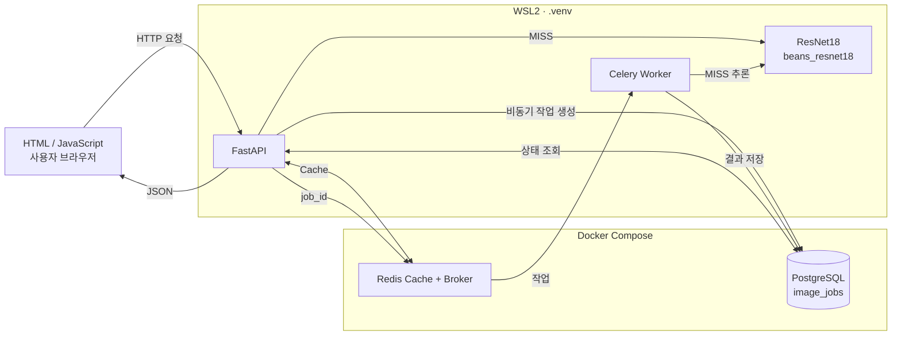
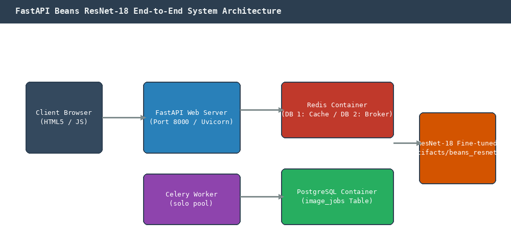
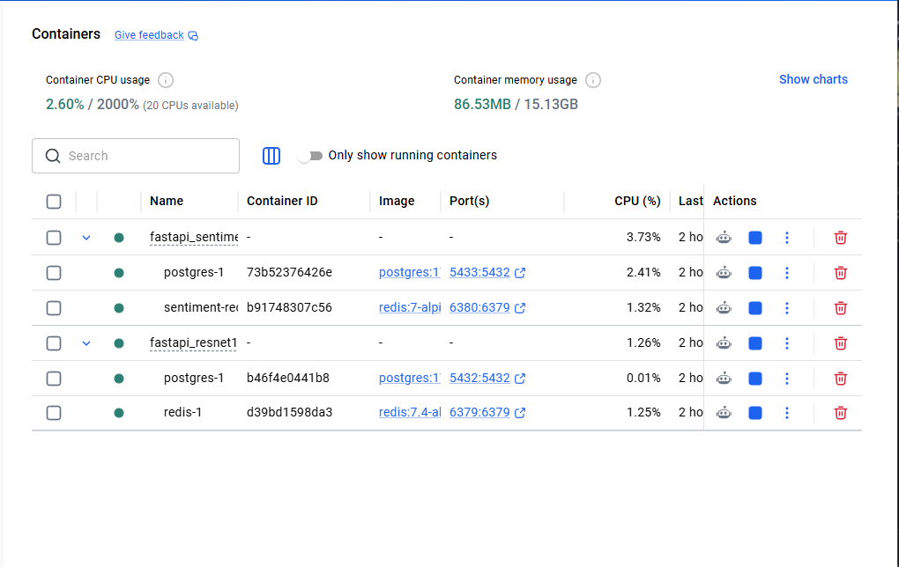

# 전체 시스템 아키텍처 설계서

본 문서는 ResNet-18 콩잎 질병 분류 시스템의 전체 구성요소 위치, 역할 분담 및 동기/비동기 데이터 흐름을 정의합니다.

---

## 1. 전체 시스템 구성도 (System Architecture)

---

## 2. 컴포넌트별 역할표 (Component Roles)

| 컴포넌트 | 실행 위치 | 사용 소스 파일 / 서비스 | 핵심 역할 및 기능 |
|---|---|---|---|
| **사용자 브라우저** | Windows 호스트 | `templates/sync.html` `templates/async.html` | 이미지 업로드, 동기 응답 확인, 비동기 상태 폴링(1초 간격) 및 렌더링 |
| **FastAPI 서버** | WSL2 `.venv` (Python 3.12) | `main.py` `ai/router_sync.py` `ai/router_async.py` | HTTP 요청 검증(5MB, 포맷), 동기 추론 중계, 비동기 접수(202) 및 전광판 조회 |
| **ResNet18 모델** | WSL2 (GPU / CPU 프로세스) | `ai/hf_model.py` `artifacts/beans_resnet18/` | 싱글톤(`lru_cache`) 메모리 로드 및 콩잎 3종 질병 추론 |
| **Redis Cache** | Docker 컨테이너 (`redis:7.4`) | `ai/cache_service.py` (Redis DB 1번) | SHA-256 이미지 지문 기반 추론 결과 캐싱 (HIT 시 추론 생략, TTL 600초) |
| **Redis Broker** | Docker 컨테이너 (`redis:7.4`) | `ai/celery_app.py` (Redis DB 2번) | 비동기 작업 큐 메시지 중계 (FastAPI ➔ Celery Worker) |
| **PostgreSQL DB** | Docker 컨테이너 (`postgres:17`) | `ai/models.py` `ai/database.py` | 비동기 작업 생애주기(`queued`➔`running`➔`done`/`failed`) 및 예측값 영구 보관 |
| **Celery Worker** | WSL2 `.venv` 별도 터미널 | `ai/tasks.py` | 큐에서 작업을 꺼내 이미지 파일 로드, AI 모델 추론 실행 및 DB 최종 갱신 |

---

## 3. 실제 구축 실행환경표 (Execution Environment)

| 항목 | 구축 사양 및 환경 | 비고 |
|---|---|---|
| **호스트 OS** | Windows 11 Home / Pro | 브라우저 구동 |
| **서브시스템 OS** | WSL2 Ubuntu 24.04 LTS (x86_64) | 리눅스 호스트 환경 |
| **가속 하드웨어 (GPU)** | NVIDIA GeForce RTX 3060 (12GB VRAM, CUDA 13.2) | PyTorch 2.15 가속 |
| **Python 환경** | Python 3.12.15 (`uv` 기반 격리 가상환경 `.venv`) | 백엔드 프로세스 런타임 |
| **Docker 서비스** | Docker Desktop (Compose v2) | 인프라 컨테이너 관리 |
| **컨테이너 목록** | `fastapi_resnet18-redis-1` (포트 6379) `fastapi_resnet18-postgres-1` (포트 5432) | Docker 격리 실행 |
| **서버 프로세스** | FastAPI (Uvicorn, 포트 8000) | WSL 호스트 프로세스 |
| **워커 프로세스** | Celery 5.6.3 (`--pool=solo`, `--concurrency=1`) | WSL 호스트 프로세스 |
| **적용 모델 경로** | `artifacts/beans_resnet18/` | Head-only Fine-tuned 모델 |

---

## 4. 인프라 실측 증빙 (Docker Container Evidence)

실제 Docker Desktop에서 Redis와 PostgreSQL 컨테이너가 정상적으로 기동 중인 화면 증빙:

