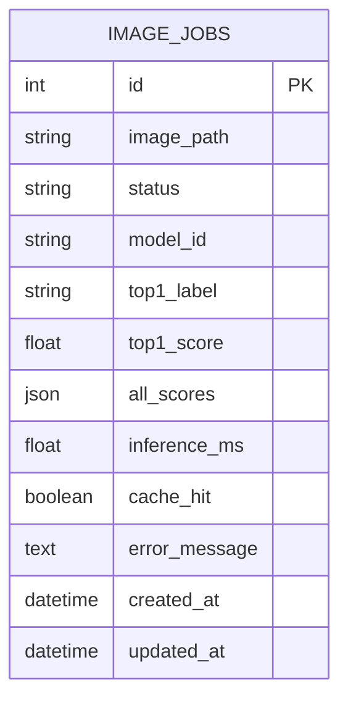

# 04_DB_구조_작업이력.md

**테이블명:** `image_jobs` · **PK:** `id` · **저장 대상:** 비동기 추론의 작업 상태 및 결과



| 컬럼 | DB 자료형(제공 코드 기준) | Nullable / 기본 | 예시 값 | 사용 이유 |
|---|---|---|---|---|
| id | INTEGER | PK | 8 | 고유 작업번호 |
| image_path | VARCHAR(150) | 필수 | `c0d9a34a...bin` | 파일 찾기 |
| status | VARCHAR(20) | 기본 `queued` | `done` | 처리 상태 |
| model_id | VARCHAR(255) | 기본 빈문자 | `artifacts/beans_resnet18` | 모델 식별 |
| top1_label | VARCHAR(200) | NULL | `bean_rust` | 최종 분류 라벨 |
| top1_score | FLOAT | NULL | 0.4632 | 분류 점수 |
| all_scores | JSON | NULL | `[{"label":"bean_rust","score":0.4632}]` | 상위 점수 |
| inference_ms | FLOAT | NULL | 71.09 | 실추론시간 |
| cache_hit | BOOLEAN | NULL | false | 캐시 재사용 여부 |
| error_message | TEXT | NULL | NULL | 실패 원인 |
| created_at | TIMESTAMPTZ | 기본 UTC 현재시각 | 2026-11-04 02:44:20+00 | 생성 시점 |
| updated_at | TIMESTAMPTZ | 기본 UTC 현재시각 | 2026-11-04 02:44:20+00 | 갱신 시점 |

PostgreSQL / DBeaver에서 **SQL 조회 [실제 실행]**

```sql
SELECT id, status, image_path, model_id, top1_label, top1_score,
       inference_ms, cache_hit, created_at, updated_at
FROM image_jobs
ORDER BY id DESC
LIMIT 10;
```

**조회 결과 기록 [실측 데이터]**

| id | status | top1_label | top1_score | cache_hit | 판정 |
|---:|---|---|---:|---|---|
| 8 | done | bean_rust | 0.4632 | true | 캐시 결과 재사용 |
| 7 | done | bean_rust | 0.4632 | false | 비동기 추론 완료 |
| 6 | done | bean_rust | 0.4632 | true | 캐시 결과 재사용 |
| 5 | done | angular_leaf_spot | 0.4822 | true | 캐시 결과 재사용 |
| 4 | done | angular_leaf_spot | 0.4822 | true | 캐시 결과 재사용 |
| 3 | done | bean_rust | 0.4773 | false | 비동기 추론 완료 |
| 2 | done | angular_leaf_spot | 0.4822 | true | 캐시 결과 재사용 |
| 1 | done | angular_leaf_spot | 0.4822 | false | 비동기 추론 완료 |

- **`failed` 작업 발생 여부:** **미발생** (모든 비동기 작업이 정상 완료되어 실패 이력 없음)

**상태 전이:** `queued → running → done` / 오류 시 `failed`  
**이미지 실제 저장 위치:** `media/jobs/<uuid>.bin` (DB 원본 이미지 바이너리 미저장)  
**동기 요청의 DB 행 생성:** 기본 제공 코드에서는 생성하지 않음

**증빙 경로:** `evidence/db_schema.png`, `evidence/db_rows.png`

**제출 점검:** 테이블이 하나이므로 실제 없는 FK·관계 테이블을 추가하지 않는다. `failed` 행은 실제로 관찰하지 못했다면 샘플처럼 임의의 작업이 있다고 주장하지 않고 `미발생`으로 기록한다.
