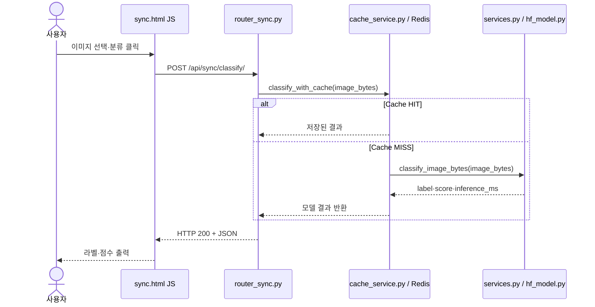
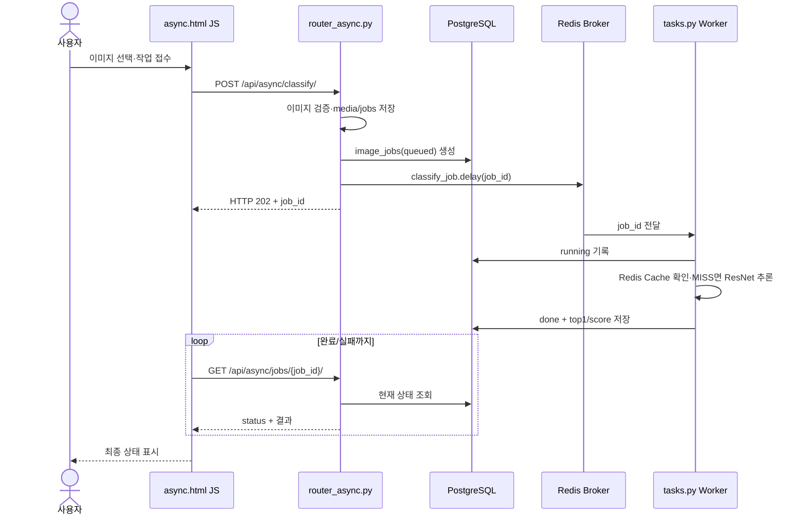
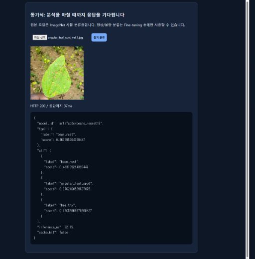
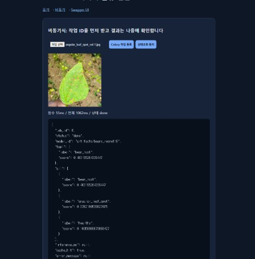
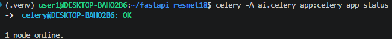

# 05_AI버튼_처리흐름.md

본 문서는 사용자가 웹 브라우저에서 '동기 분석' 및 '비동기(Celery) 작업 접수' 버튼을 클릭했을 때 발생하는 내부 코드 실행 순서, 호출 함수, 컴포넌트 간 상호작용 및 데이터 흐름을 시퀀스 다이어그램으로 상세히 정의합니다.

---

**A. 동기 버튼 클릭 시**

---

**B. 비동기 버튼 클릭 시**

---

**실제 코드 연결표**

| 단계 | 시작 파일 | 핵심 함수·처리 | 반환 / 다음 단계 |
|---|---|---|---|
| 동기 1 | `templates/sync.html` | `fetch()` | `POST /api/sync/classify/` |
| 동기 2 | `ai/router_sync.py` | `classify_sync()` | `classify_with_cache()` |
| 동기 3 | `ai/cache_service.py` | `classify_with_cache()` | Cache HIT 또는 `classify_image_bytes()` |
| 동기 4 | `ai/services.py` | `load_rgb_image()` · `get_classifier()` 호출 | `top1`, `all` |
| 비동기 1 | `ai/router_async.py` | `enqueue_classify()` | DB `queued`, `202/job_id` |
| 비동기 2 | `ai/tasks.py` | `classify_job()` | DB `running` → `done` / `failed` |
| 비동기 3 | `ai/router_async.py` | `get_job()` | 상태 및 예측 JSON |

---

**비교 결론**
- **동기:** HTTP 응답을 받을 때 즉시 추론 결과가 포함된다 (단일 요청-응답 완료).
- **비동기:** HTTP 202 접수 후 클라이언트의 별도 Polling 조회가 필요하다 (접수와 결과 분리).
- **공통점:** 백그라운드나 전면에서 분류 자체를 실행하는 ResNet18 모델 및 전처리 로직은 동일하다.

---

**증빙:** `evidence/ui_sync.png`, `evidence/ui_async.png`, `evidence/celery_log.png`

