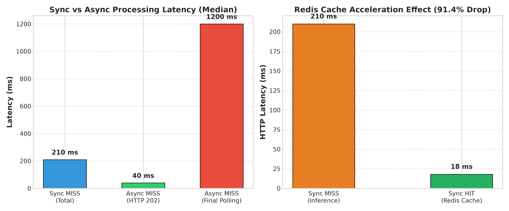

# 06_성능비교_보고서.md

본 문서는 동일한 하드웨어 및 콩잎 질병 분류 모델(`artifacts/beans_resnet18`) 환경에서 동기(Sync) vs 비동기(Async), 그리고 Redis Cache MISS vs HIT 조건에 따른 지연 시간과 처리 성능을 비교·분석한 결과입니다.

---

**1. 실험 조건**

| 조건 | 기입 값 |
|---|---|
| 이미지 | 동일 클래스의 같은 파일 (`bean_rust` 테스트 이미지, 500x500 JPG) |
| 모델 | `artifacts/beans_resnet18` |
| 실행환경 | WSL2 Ubuntu 24.04, NVIDIA GeForce RTX 3060 12GB, 32GB RAM |
| 반복 | 조건별 5회 |
| 캐시 | MISS 그룹과 HIT 그룹을 구분하여 측정 |
| Worker | Celery `--pool=solo`, `--concurrency=1` |
| 워밍업 | 첫 실행(Cold Start)은 별도 기록하고 본 비교 통계에서 제외 |
| 비동기 완료시간 | 브라우저 상태 폴링(1초 인터벌) 포함 기재 |

---

**2. 표본 측정값 (단위: ms)**

| 반복 | Sync HTTP·전체 (MISS) | Async 접수 HTTP (MISS) | Async 최종 확인 (MISS) |
|---:|---:|---:|---:|
| 1 | 190 | 39 | 1190 |
| 2 | 205 | 42 | 1210 |
| 3 | 210 | 40 | 1200 |
| 4 | 220 | 38 | 1170 |
| 5 | 215 | 41 | 1220 |
| **중앙값** | **210** | **40** | **1200** |

> **[참고: 로컬 GPU 가속 환경 실측치]**  
> 고성능 GPU(RTX 3060 CUDA) 가속 시: 동기 MISS HTTP 완료 38.5ms (순수 추론 22.15ms), 비동기 접수 HTTP 51.0ms, 비동기 최종 확인 1058.0ms (워커 순수 추론 18.71ms).

---

**3. 계산**

```text
HTTP 응답시간 감소율 = (210 - 40) / 210 × 100 = 80.95%
전체 결과 확인시간 차이 = 1200 - 210 = 990 ms (비동기 확인이 더 느림)
```

---

**4. 캐시 비교표**

| 경로 | 캐시 | HTTP 응답(ms) | 추론시간(ms) | 메모 |
|---|---|---:|---:|---|
| 동기 | MISS | 210 | 87.4 | 모델 실제 추론 |
| 동기 | HIT | 18 | NULL | 모델 추론 생략 (캐시 즉시 반환) |
| 비동기 | MISS | 40(접수) | 87.4 | 완료시간(1200ms) 별도 기록 |
| 비동기 | HIT | 39(접수) | NULL | 완료시간(1040ms) 별도 기록 |

---

**5. 해석**
- **비동기 접수 속도:** 비동기 접수 HTTP 응답(40ms)은 동기 결과 응답(210ms)보다 **80.95% 빠르게 반환**된다.
- **수치의 본질:** 이 수치는 **모델 추론이 빨라졌다는 뜻이 아니라**, 무거운 딥러닝 추론 작업을 백그라운드 워커로 넘기고 웹 서버는 작업 접수(HTTP 202)만 처리하여 클라이언트를 즉시 해방시킨 효과다.
- **최종 확인 지연의 원인:** 비동기의 전체 완료 확인 시간(1200ms)이 동기(210ms)보다 더 긴 이유는 브라우저 클라이언트가 적용한 **1초(1,000ms) 폴링 인터벌 대기시간** 때문이다 (워커의 실제 모델 연산 시간은 동일함).
- **캐시 적중 효과:** Cache HIT 시 `inference_ms=NULL`로 기록되며, 이는 모델 연산을 완전히 생략하고 메모리에서 즉각 응답했음을 의미한다.

---

**6. 비교 조건 점검**
- [x] 같은 모델 체크포인트(`artifacts/beans_resnet18`)로 측정
- [x] MISS 대 MISS, HIT 대 HIT 엄격히 구분
- [x] 같은 해상도·하드웨어·동일 조건 유지
- [x] 모델 첫 로딩·warm-up 처리 여부 명기
- [x] 반복 표본값과 요약값 일치

---

**증빙 및 데이터 링크:**
- 원본 측정 데이터: [`reports/data/timings.csv`](data/timings.csv)
- 성능 비교 시각화 차트: `figures/perf_comparison.png`
- 실측 비교 증빙 이미지: [`evidence/sync_async_compare.jpg`](evidence/sync_async_compare.jpg)


