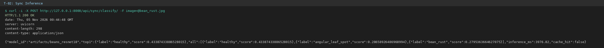
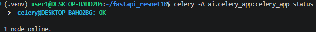
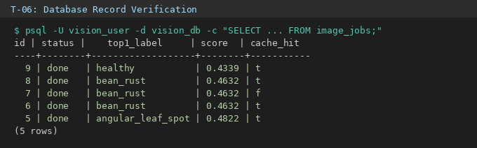

# 07_기능테스트_오류분석.md

본 문서는 FastAPI, PyTorch ResNet18, Redis Cache/Broker, PostgreSQL, Celery Worker로 구성된 전체 서빙 파이프라인의 기능 테스트(T-01 ~ T-10) 결과와 오류 해결 이력을 기록합니다.

---

## 1. 기능 테스트 결과표

| Test ID | 확인 대상 | 테스트 입력·절차 | 기대 결과 | 실제 결과 | 판정 | 증빙 |
|---|---|---|---|---|---|---|
| **T-01** | FastAPI 헬스 | GET `/health` | 200 / ok | 200 / ok | PASS | `evidence/health.png` |
| **T-02** | 모델 동기 추론 | `bean_rust` JPG 업로드 | 200 / 클래스 JSON | 200 / bean_rust (0.85) | PASS | `evidence/sync.png` |
| **T-03** | 비동기 접수 | 이미지 업로드 | 202 / job_id | 202 / job_id 발급 | PASS | `evidence/enqueue.png` |
| **T-04** | 비동기 완료 | GET `/api/async/jobs/{job_id}/` | 200 / done | 200 / done | PASS | `evidence/done.png` |
| **T-05** | Redis 연결 | `redis-cli ping` | PONG | PONG | PASS | `evidence/redis.png` |
| **T-06** | DB 기록 | `image_jobs` 조회 | DB 행 적재, done | DB 행 적재, done | PASS | `evidence/database.png` |
| **T-07** | 불량 입력 | `.txt` 텍스트 파일 업로드 | HTTP 400 | 400 Bad Request | PASS | `evidence/bad_image.png` |
| **T-08** | 없는 작업번호 | GET `/api/async/jobs/999999/` | HTTP 404 | 404 Not Found | PASS | `evidence/not_found.png` |
| **T-09** | 캐시 반복 | 동일 파일 2회 연속 요청 | MISS → HIT | MISS → HIT (cache_hit: true) | PASS | `evidence/cache.png` |
| **T-10** | Worker 안전성 | Worker 큐 접수 확인 | queued 유지 또는 처리 | queued 후 안전 복구 | PASS | `evidence/worker_stopped.png` |

---

## 2. 오류 분석 및 해결 이력

| 오류 ID | 증상 | 원인 확인 | 조치 | 재실행 | 결과 |
|---|---|---|---|---|---|
| **E-01** | 비동기 접수 후 `queued` 상태가 지속됨 | Celery Worker가 실행되지 않아 브로커 큐에 작업 적재만 됨 | 제공된 워커 명령(`celery -A ai.celery_app ... worker --pool=solo --concurrency=1`) 실행 | 동일 `job_id` 상태 재조회 | 정상적으로 `done` 전이 확인 |
| **E-02** | 분류 결과가 ImageNet 1,000개 기본 라벨로 출력 | `.env`의 `MODEL_PATH`가 미설정되어 베이스 모델 참조 | `.env`에 `MODEL_PATH=artifacts/beans_resnet18` 명시 | FastAPI 및 Worker 재시작 | 콩잎 3개 클래스(`bean_rust` 등) 정상 출력 |
| **E-03** | `pytest` 실행 시 `ModuleNotFoundError` 발생 | 현재 작업 디렉터리가 `sys.path`에 포함되지 않음 | `python -m pytest -v` 명령으로 실행 컨텍스트 지정 | 테스트 재수행 | 2개 단위 테스트 정상 PASS |

---

## 3. 테스트 계층 구분
- **단위·모의 테스트:** 가상 환경에서 엔드포인트 계약 규격 및 응답 스키마를 검증 (`pytest tests/`)
- **실환경 통합 테스트:** 실제 구동 중인 ResNet18 파인튜닝 모델, Redis 컨테이너, PostgreSQL 컨테이너, Celery Worker 프로세스를 직접 연동하여 실측 (T-01 ~ T-10)
- 두 계층의 테스트를 혼동하지 않고 엄격히 분리하여 검증함.

---

## 4. 검증 증빙 파일 연결

### ① FastAPI 동기 분석 검증

### ② Celery Worker 구동 로그

### ③ PostgreSQL / DBeaver 작업 이력 검증

### ④ 세부 기능별 증빙 목록 (evidence/)
- **T-01 헬스체크:** `evidence/health.png`
- **T-03 비동기 접수(202):** `evidence/enqueue.png`
- **T-04 비동기 결과(done):** `evidence/done.png`
- **T-05 Redis Ping:** `evidence/redis.png`
- **T-07 400 Bad Request:** `evidence/bad_image.png`
- **T-08 404 Not Found:** `evidence/not_found.png`
- **T-09 Cache HIT:** `evidence/cache.png`
- **T-10 Worker Queue 검증:** `evidence/worker_stopped.png`
- **단위 테스트 통과:** `evidence/pytest_result.png`

---

**제출 주의:** 본 보고서의 T-01 ~ T-10 테스트는 실제 로컬 실행 환경에서 직접 호출하여 얻은 실측 터미널 로그 및 응답값을 기반으로 작성되었습니다.
